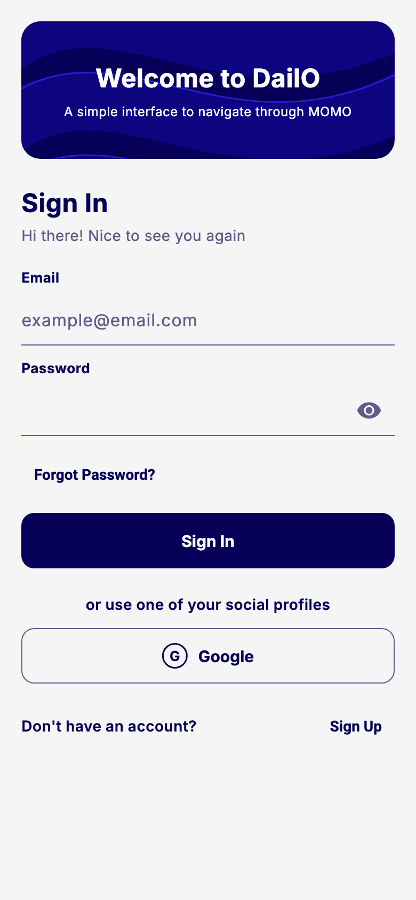
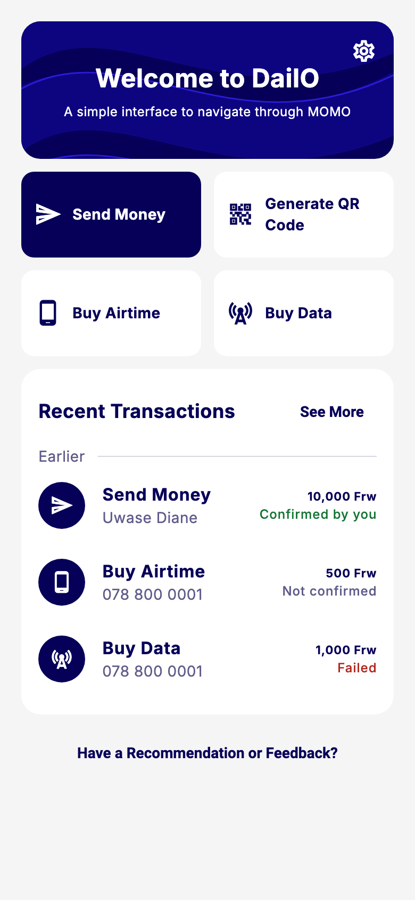
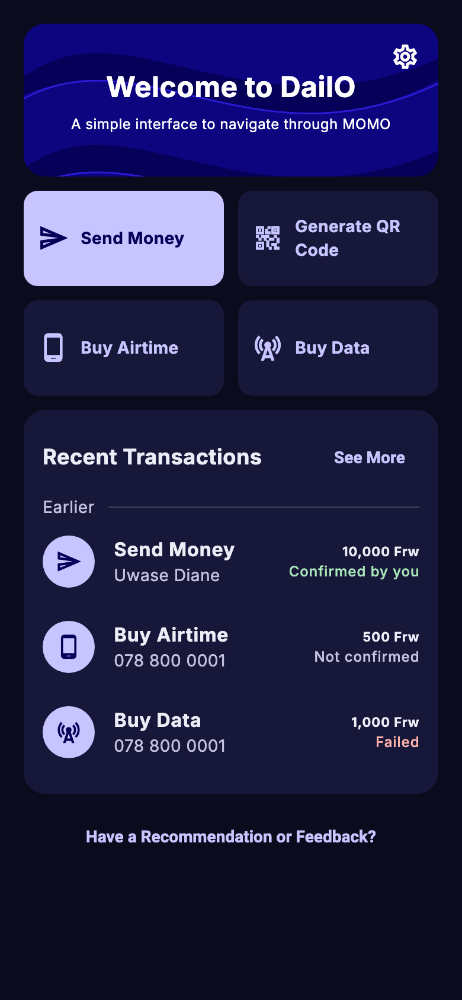
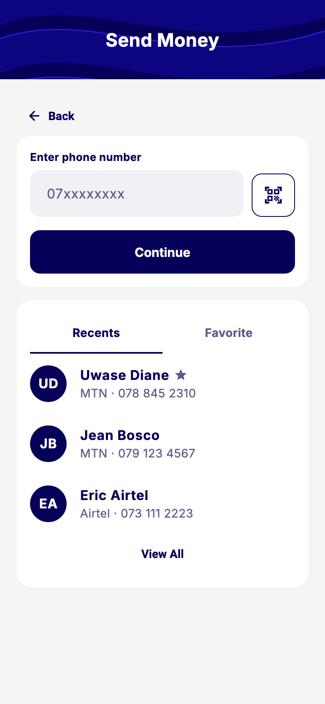
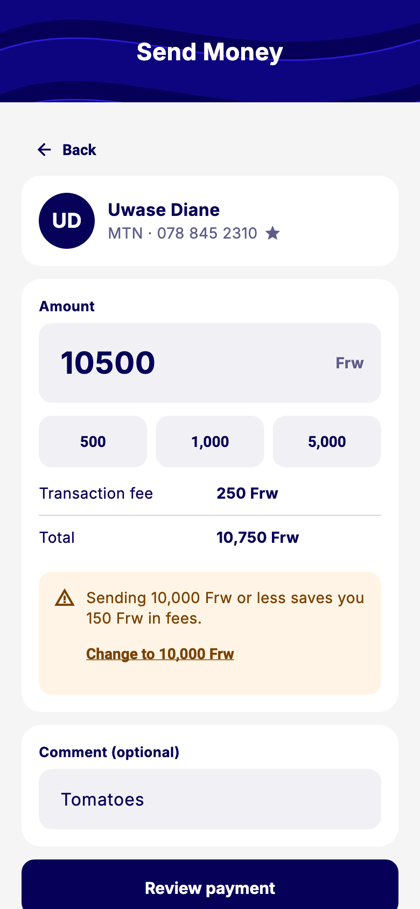
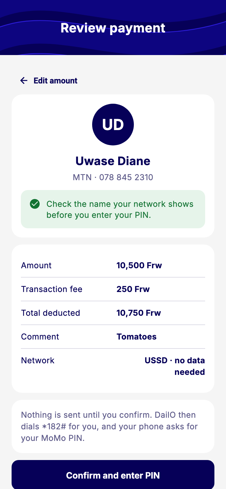
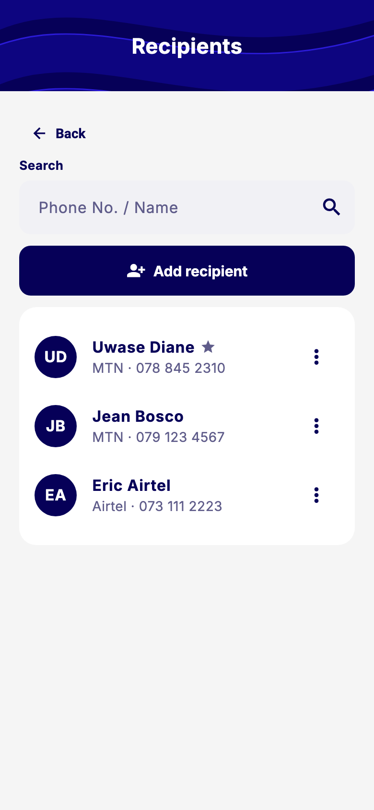
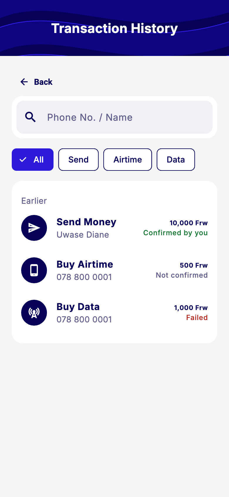

# DailO

A Flutter app for Android that turns the mobile money `*182#` menu into guided screens. You pick a saved recipient or scan a QR code, type an amount, see the exact fee, confirm, and the phone dials the USSD code for you. Sending money needs no mobile data.

Built by Summative Project Group 22 for Mobile Application Development at African Leadership University.

## What it does

- Send money in four steps: recipient, amount, review, confirm. The fee shows as you type, with a warning when a slightly smaller amount would cost a lower fee.
- Save recipients, mark favourites, search, edit and delete them.
- Show your own payment QR code, and scan someone else's.
- Buy airtime and data.
- Keep a history of every payment and purchase, with search, filters and a detail page.
- Sign in with email and password or with Google. New email accounts verify their address first.
- Remember four preferences on the phone: dark mode, default network, fee warning and language (English or Kinyarwanda).

The MoMo PIN is never typed into DailO. The network's own USSD dialog asks for it.

## Screens

The pictures are drawn by the widget tests at phone size, with the same sample data the tests use.

<table>
  <tr>
    <td></td>
    <td></td>
    <td></td>
    <td></td>
  </tr>
  <tr>
    <td align="center">Sign in</td>
    <td align="center">Home</td>
    <td align="center">Dark mode</td>
    <td align="center">Send money</td>
  </tr>
  <tr>
    <td></td>
    <td></td>
    <td></td>
    <td></td>
  </tr>
  <tr>
    <td align="center">Amount</td>
    <td align="center">Review</td>
    <td align="center">Recipients</td>
    <td align="center">History</td>
  </tr>
</table>

## Run it

You need Flutter 3.47 or newer and an Android phone or emulator. Web and desktop are not supported.

```
flutter pub get
flutter run
```

On an emulator there is no SIM card, so use the simulated dialer:

```
flutter run --dart-define=SIMULATE_USSD=true
```

The Firebase project is already configured in `android/app/google-services.json` and `lib/firebase_options.dart`. Google sign-in only works on a build signed with a key registered in that Firebase project.

## Test it

```
flutter analyze
flutter test
tool/check.sh
```

`tool/check.sh` is the full gate: format, analyzer, architecture rules, 787 tests and a 70% coverage floor. The security rules have their own 182 tests, described in `docs/security_rules.md`. More detail is in `docs/testing.md`.

## How the code is organised

```
lib/
  main.dart               starts Firebase, the offline cache and the app
  app.dart                creates the cubits, applies theme and language, picks the first screen
  app_dependencies.dart   the repositories and the dialer the app is given
  core/                   theme, route names, validators, formatters, strings in two languages
  domain/
    entities/             AppUser, Recipient, TransactionRecord, FeedbackNote, AppSettings
    logic/                fee table, phone number rules, USSD codes, QR text
    repositories/         what the app needs from storage, as interfaces
    services/             the dialer, as an interface
  data/
    repositories/         Firebase Authentication, Cloud Firestore and SharedPreferences
    services/             the Android dialer and a simulated one
  presentation/
    cubits/               one cubit per feature, holding all the logic the screens use
    screens/              one file per screen
    widgets/              shared widgets and the small widgets each area needs
test/                     unit, cubit, widget, layout and whole-app tests
rules_test/               security rules tests
```

The three layers only point inwards. Screens talk to cubits. Cubits talk to the interfaces in `domain`. The classes in `data` implement those interfaces with Firebase. No screen imports Firebase, and `setState` is not used anywhere.

## State management

DailO uses Cubit from `flutter_bloc`. Each cubit owns one feature's state and exposes plain methods such as `signIn`, `add` or `confirm`. A screen rebuilds from the state with `BlocBuilder` and shows one-off messages with `BlocListener`.

The Recipients screen and Send Money both read the same `RecipientsCubit`, so a recipient added on one screen shows on the other at once.

## Database

Cloud Firestore, with everything a user owns under `users/{uid}`. The diagram and the reasons behind it are in `docs/erd.md`. The rules that protect it are explained in `docs/security_rules.md`.

## Known limitations

- DailO cannot read the network's answer, so it asks you whether the payment went through.
- Fees are MTN's published table. For an Airtel line the network shows the fee.
- The first sign-in needs a connection. Payments after that do not.
- Android only. iOS does not let an app dial USSD codes.

## Team

Alieu O Jobe, Cyuzuzo Germain, Erioluwa Gideon Olowoyo, Nkingi Gakindi Chris, Wisdom Ikechukwu Okechukwu. Who built what is in `docs/TASKS.md`.
