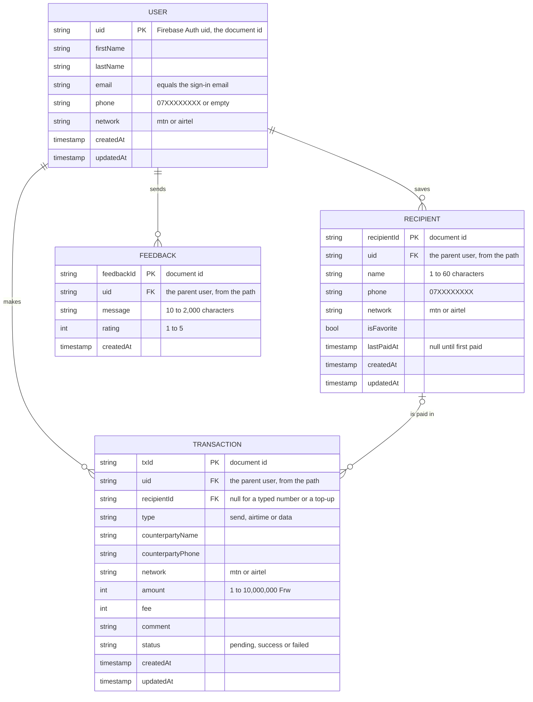

# Database: ERD and notes

DailO stores its data in Cloud Firestore. Everything a user owns sits under their own `users/{uid}` document, so one rule can protect all of it.

## Entity-relationship diagram

## How the diagram maps to Firestore

| Entity | Firestore path | Dart class |
|---|---|---|
| USER | `users/{uid}` | `AppUser` in `lib/domain/entities/app_user.dart` |
| RECIPIENT | `users/{uid}/recipients/{recipientId}` | `Recipient` in `recipient.dart` |
| TRANSACTION | `users/{uid}/transactions/{txId}` | `TransactionRecord` in `transaction_record.dart` |
| FEEDBACK | `users/{uid}/feedback/{feedbackId}` | `FeedbackNote` in `feedback_note.dart` |

Firestore has no foreign keys. The `uid` key is the path itself: a recipient can only exist inside its owner's document. `recipientId` on a transaction is stored as a field.

Each Dart class lists its stored field names in a `fields` constant, and `toMap()` writes exactly those. The test `test/unit/entities_test.dart` fails if a class writes a field that is not in the list, so the code and this diagram cannot drift apart.

## Design decisions

- A transaction keeps `counterpartyName` and `counterpartyPhone` as they were at payment time. A receipt must not change when the recipient is renamed or deleted later. This is the only repeated data, and it is repeated on purpose.
- The total is never stored. It is always `amount + fee`, computed by `TransactionRecord.total`.
- The fee table and the USSD codes are not in the database. They are constants in `lib/domain/logic/`, so a payment needs no network call.
- Preferences (theme, default network, fee warning, language) are kept on the phone with SharedPreferences, not in Firestore.

## Index

`firestore.indexes.json` holds one composite index: `recipients` by `isFavorite` descending, then `name` ascending. The recipients query in `lib/data/repositories/firestore_recipient_repository.dart` orders by those two fields, and Firestore needs a composite index for any query that orders by more than one field. The transactions query orders by `createdAt` only, which Firestore indexes on its own.

## Offline behaviour

Firestore's local cache is switched on in `lib/main.dart`. A write is applied to the cache first and sent to the server when a connection is available. That is why a payment record is saved even with mobile data off, and why the list on screen updates at once.
